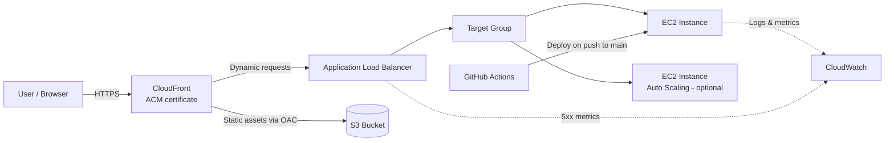

# AWS-Project-End-to-End-Cloud-Solution-Design-Deployment

# End-to-End Cloud Solution Design & Deployment

A secure, highly available and scalable web application deployed on AWS, built as a group project using GitHub for version control and Trello for project management. Everything is designed to run within the AWS Free Tier.

---

## The Problem

A fast-growing startup has launched a new web application, but users are dealing with:

- Slow page load times
- Inconsistent availability during peak traffic
- Concerns about the security of the application
- No structured deployment process, which makes collaboration hard and increases the risk of deployment errors

They need a secure, highly available and scalable cloud solution that fits a limited budget and supports future growth.

## Our Solution

We serve the app through **Amazon CloudFront** (CDN + HTTPS), which sends traffic to an **Application Load Balancer**, which spreads it across **EC2** instances running the web app. Static assets (images, CSS, JS) are stored in **S3** and only accessible through CloudFront. Deployments are automated with **GitHub Actions**, and **CloudWatch** keeps an eye on health and errors.

### Architecture



> A full architecture diagram will be added to `/docs` in Phase 4.

---

## Tech Stack

| Area | Tools |
|---|---|
| Compute | Amazon EC2 (t2.micro / t3.micro), Auto Scaling Group (optional) |
| Load balancing | Application Load Balancer, Target Groups |
| CDN & HTTPS | Amazon CloudFront, AWS Certificate Manager (ACM) |
| Storage | Amazon S3 (static assets, private via Origin Access Control) |
| Security | IAM (least privilege), Security Groups, CloudFront managed prefix lists |
| CI/CD | GitHub Actions |
| Monitoring & cost | CloudWatch Alarms & Logs, AWS Budgets |
| Collaboration | GitHub, Trello |
| Web app | HTML / CSS / JavaScript |

---

## Repository Structure

```
.
├── app/                  # Web application source (HTML, CSS, JS)
├── static/               # Static assets to upload to S3
├── scripts/              # Deployment and setup scripts
├── .github/workflows/    # GitHub Actions CI/CD workflows
├── docs/                 # Architecture diagram, screenshots, notes
└── README.md
```

*(Update this as the project takes shape.)*

---

## Branching Strategy

| Branch | Purpose |
|---|---|
| `main` | Production-ready code only. Pushes here trigger deployment. |
| `develop` | Integration branch where finished features come together and get tested. |
| `feature/<short-name>` | One branch per task, e.g. `feature/alb-setup`, `feature/home-page`. |

**Workflow**

1. Pick a card on Trello and assign yourself.
2. Create a branch from `develop`: `git checkout -b feature/<short-name> develop`
3. Commit small, clear changes.
4. Open a Pull Request into `develop` and get at least one teammate to review it.
5. When `develop` is stable, open a PR from `develop` into `main`.

No direct pushes to `main`.

---

## Environment Setup (Phase 1)

### 1. AWS account & IAM
- Create the AWS Free Tier account and turn on MFA for the root user.
- Create an IAM user for each team member with least-privilege permissions. Don't use the root account for daily work.
- *Document the IAM groups/policies used here.*

### 2. AWS CLI
Install the AWS CLI v2, then set up a named profile:

```bash
aws configure --profile <profile-name>
aws sts get-caller-identity --profile <profile-name>   # check it works
```

Never commit access keys to this repo.

### 3. EC2
- Instance type: `t2.micro` / `t3.micro` (Free Tier eligible)
- Region: `<region>`
- Security group: allow HTTP (80) and HTTPS (443). SSH (22) from team IPs only.
- *Later (Phase 3): restrict inbound traffic to CloudFront only.*

### 4. S3
- Bucket name: `<bucket-name>`
- Used for static assets.
- *Phase 3: block public access and allow reads only through CloudFront OAC.*

### 5. SSL/TLS certificate (ACM)
- Request a free public certificate for `<custom-domain>`.
- Note: certificates used with CloudFront **must be requested in `us-east-1`**.

---

## Project Phases

- [ ] **Phase 1:** Project setup & environment configuration
- [ ] **Phase 2:** Web app development & deployment (EC2 + ALB)
- [ ] **Phase 3:** Security hardening & CloudFront integration
- [ ] **Phase 4:** CI/CD pipeline, monitoring & cost management
- [ ] **Phase 5:** Presentation & project showcase

---

## Project Management

Tasks are tracked on Trello with the columns **Backlog → In Progress → Review → Done**.

Trello board: `<link>`

---

## Live Demo

CloudFront URL: `<coming soon>`

---

## Team

| Name | Role |
|---|---|
| `<name>` | `<role>` |
| `<name>` | `<role>` |
| `<name>` | `<role>` |

---

## Cost Notes

This project is built to stay within the AWS Free Tier. An AWS Budgets alert is set up to warn us before costs go over the limit. Remember to **stop or delete resources** (especially the ALB and EC2 instances) when they're not in use.
